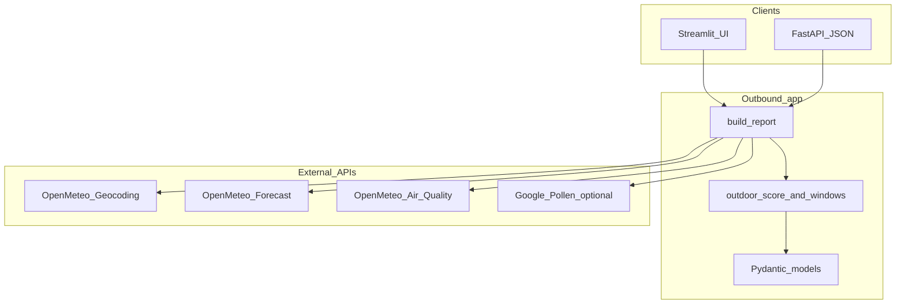
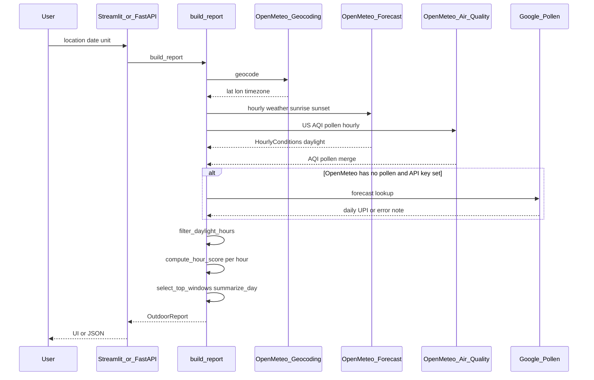
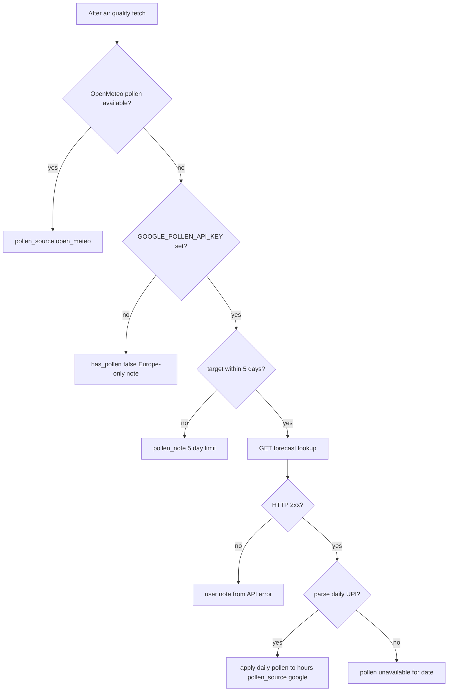
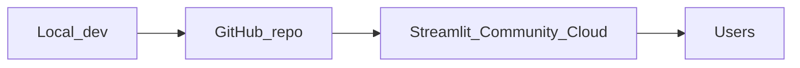

# Outbound architecture

Outbound is a stateless Python application: no database, no auth. A single orchestration function (`build_report`) fetches external APIs, scores daylight hours, and returns a typed `OutdoorReport` consumed by Streamlit and FastAPI.

## System context

## Request flow

Both entry points call `build_report(location, temperature_unit, forecast_date)` in [`app/report.py`](../app/report.py).

Shared HTTP client: one `httpx.AsyncClient` per report for geocoding, forecast, air quality, and optional Google pollen.

## Pollen resolution

Pollen affects scoring via [`app/outdoor_score.py`](../app/outdoor_score.py) (UPI 0–5 for Google, grains/m³ for Open-Meteo). Weights renormalize when pollen is missing.

Google error handling lives in [`app/services/pollen_google.py`](../app/services/pollen_google.py) (`_note_from_google_http_error`).

## Module map

| Layer | Responsibility | Paths |
|-------|----------------|-------|
| Entry | HTTP UI and JSON API | [`app/ui/streamlit_app.py`](../app/ui/streamlit_app.py), [`app/main.py`](../app/main.py) |
| Orchestration | Fetch, merge, score, assemble report | [`app/report.py`](../app/report.py) |
| Domain | Scoring, windows, day summary, dates | [`app/outdoor_score.py`](../app/outdoor_score.py), [`app/day_summary.py`](../app/day_summary.py), [`app/forecast_date.py`](../app/forecast_date.py) |
| Integrations | External APIs | [`app/services/geocoding.py`](../app/services/geocoding.py), [`app/services/weather.py`](../app/services/weather.py), [`app/services/air_quality.py`](../app/services/air_quality.py), [`app/services/pollen_google.py`](../app/services/pollen_google.py), [`app/services/daylight.py`](../app/services/daylight.py) |
| Config | URLs, weights, env, dotenv | [`app/config.py`](../app/config.py) |
| Models | Pydantic schemas | [`app/models.py`](../app/models.py) |

## Configuration loading

On import, [`app/config.py`](../app/config.py) loads `.env` from the project root (if present). Streamlit Community Cloud uses **Secrets** instead; the same variable names apply. See [README](../README.md#configuration).

## Deployment topology

FastAPI is intended for local use or a separate host; Streamlit Cloud runs only the Streamlit entry point.
